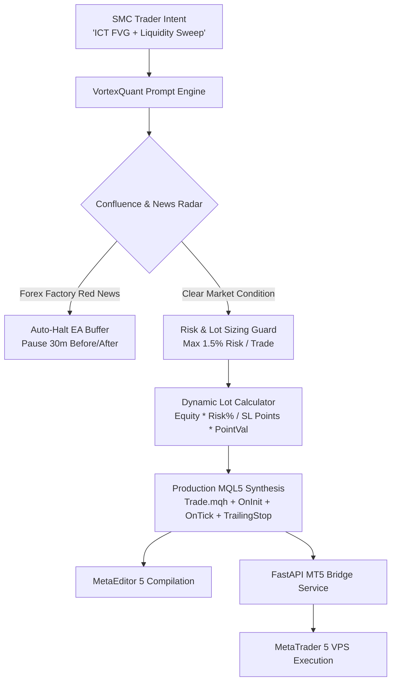

# VortexQuant: Institutional SMC & MQL5 Algorithmic Terminal

> **VortexQuant** is an institutional-grade Smart Money Concepts (SMC) & MQL5 Expert Advisor (EA) Terminal. Engineered with real-time Forex Factory economic news shield, live breaking market wire feeds, institutional liquidity sweep detection, dynamic risk guardrails, and compilable MetaTrader 5 `.mq5` code synthesis.

---

## 🚀 Live Terminal Interface
Experience the live algorithmic terminal:
🔗 **[https://varnit-vortex.github.io/quant-mql5-copilot/](https://varnit-vortex.github.io/quant-mql5-copilot/)**

---

## 🏛️ System Architecture

---

## ✨ Core Highlights

### 1. Smart Money Concepts (SMC) & MQL5 Synthesis
- Translates advanced institutional logic (Asian session liquidity sweeps, Fair Value Gaps [FVG], Break of Structure [BOS], Order Blocks) into production MetaTrader 5 code.
- Uses `iTime()` bar-close confirmation to completely eliminate tick repainting.
- Dynamic lot sizing protects against margin blowouts.

### 2. Live Forex Factory Radar & Breaking Market Wire
- Dual-mode institutional news radar:
  - **Forex Factory Calendar**: Real-time high-impact 🔴 red folder event tracking (CPI, FOMC, NFP, ECB) with automated EA news shields.
  - **Live Breaking News Wire**: Real-time financial headlines (Reuters, Bloomberg) with automated sentiment impacts.

### 3. Complete TradingView-Grade Charting
- Real-time tick simulator with interactive crosshair inspection.
- Y-axis price scale with animated live price badge and dotted execution line.
- Timezone switcher: **EST (New York)**, **UTC (London)**, and **IST (Local India)**.

---

## 👨‍💻 Developer Profile

**Varnit Bhardwaj**  
*Agentic Systems & Quantitative Algorithmic Developer*  
- **Certification**: Certified in Agentic Systems and Design by **iHUB DivyaSampark, IIT Roorkee** & Masai School (9.4/10 Evaluation Score, 100% Attendance).
- **Core Skills**: Python, LangGraph, MetaTrader 5 (MQL5), Smart Money Concepts (SMC), FastAPI, RAG, Financial Time-Series.
- **Upwork Profile**: [Varnit B. on Upwork](https://www.upwork.com/freelancers/~01a695e72a7445ecf2)
