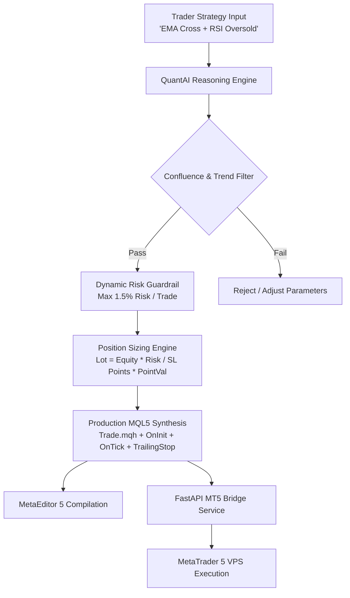

# QuantAI: Autonomous MQL5 & Quantitative Trading Copilot

> **QuantAI** is an institutional-grade Quantitative Trading & MQL5 Expert Advisor (EA) Copilot. Built with agentic reasoning, real-time technical indicators, dynamic risk management guardrails, and compilable MetaTrader 5 `.mq5` code synthesis.

---

## 🚀 Live Demo
Experience the live terminal interface and generate compilable MQL5 scripts:
🔗 **[https://varnit-vortex.github.io/quant-mql5-copilot/](https://varnit-vortex.github.io/quant-mql5-copilot/)**

---

## 🏛️ System Architecture

---

## ✨ Core Features

### 1. Natural Language ➡️ Compilable MQL5 EA (.mq5)
- Translates trading logic and smart money concepts (EMA crossovers, ICT Fair Value Gaps, Bollinger Bands, MACD Divergence) into robust MetaTrader 5 code.
- Fully incorporates `#include <Trade\Trade.mqh>`, `OnInit()`, `OnDeinit()`, `OnTick()`, and input parameter grouping.
- Uses `iTime()` bar-close confirmation to eliminate tick repainting.

### 2. Quantitative Risk & Drawdown Circuit Breakers
- **Dynamic Lot Sizing**: Automatically sizes positions according to account balance, point value, and exact Stop Loss distance.
- **Trailing Stop Engine**: Locks in profit automatically once favorable price excursion exceeds predefined threshold.
- **Emergency Drawdown Kill Switch**: Prevents margin blowouts by halting EA activity if daily drawdown exceeds 3.0%.

### 3. Bloomberg-Style Dark Terminal UI
- Real-time tick simulator on Gold (`XAUUSD`), Forex (`EURUSD`), Crypto (`BTCUSD`), and Tech (`NAS100`).
- Canvas-based candlestick visualizer with moving averages and trade execution markers.
- Integrated MQL5 syntax viewer, 1-click clipboard copy, and `.mq5` file downloader.

### 4. Python MetaTrader 5 Bridge
- Includes ready-to-deploy FastAPI microservice connecting Webhooks and LangGraph agents to a local/remote MetaTrader 5 terminal via the official `MetaTrader5` Python package.

---

## 🧪 Preset Strategy Blueprints
| Strategy | Indicators | Target Market | Expected Sharpe |
| :--- | :--- | :--- | :--- |
| **EMA Golden Cross + RSI** | 20 EMA, 50 EMA, RSI(14) | XAUUSD, EURUSD | 1.84 |
| **ICT FVG + Liquidity Sweep** | Fair Value Gap, Asian Range High/Low | EURUSD, GBPUSD | 2.14 |
| **Bollinger Scalper** | 20 SMA, 2.0 StdDev, Stochastic | US100, BTCUSD | 1.62 |
| **MACD Multi-Timeframe** | H1 200 EMA + M5 MACD Histogram | Gold (XAUUSD) | 1.95 |

---

## 👨‍💻 Developer Profile

**Varnit Bhardwaj**  
*Agentic Systems & Quantitative Algorithmic Developer*  
- **Certification**: Certified in Agentic Systems and Design by **iHUB DivyaSampark, IIT Roorkee** & Masai School (9.4/10 Evaluation Score, 100% Attendance).
- **Core Skills**: Python, LangGraph, MetaTrader 5 (MQL5), FastAPI, RAG, Financial Time-Series Analysis.
- **Upwork Profile**: [Varnit B. on Upwork](https://www.upwork.com/freelancers/~01a695e72a7445ecf2)
- **Portfolio Projects**:
  - [PulseAI Healthcare Copilot](https://varnit-vortex.github.io/pulse-ai-copilot/)
  - [Cred Support Agent](https://varnit-vortex.github.io/Cred-Domain-Support-Agent-/)
  - [QuantAI MQL5 Copilot](https://varnit-vortex.github.io/quant-mql5-copilot/)
